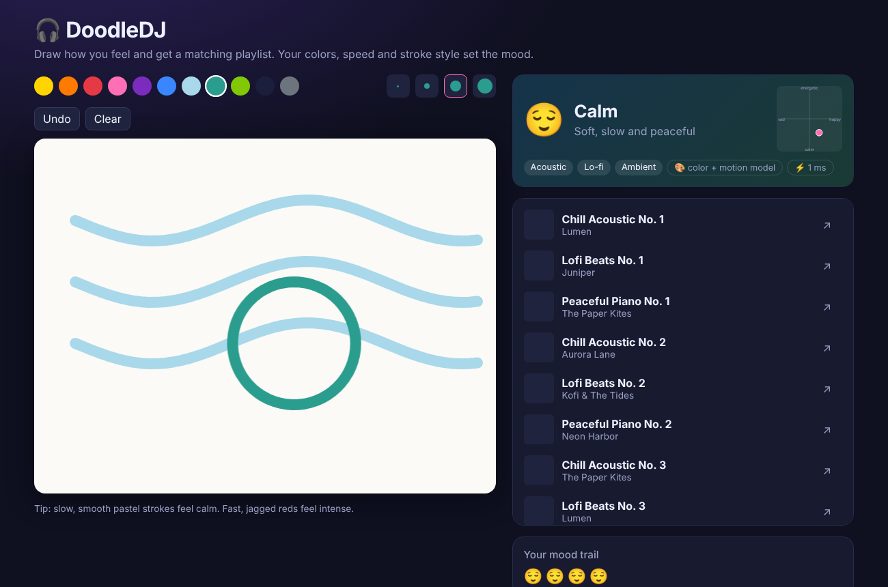
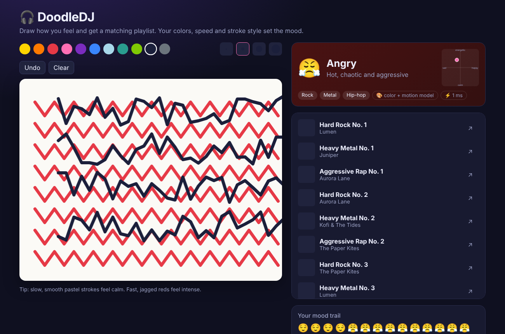

# 🎧 DoodleDJ: AI-Powered Mood-Based Music Curator

Draw how you feel, and DoodleDJ turns it into a playlist. Each time you finish a stroke, the app reads the
emotion in your sketch from your colors, speed and stroke style. It can refine that mood with an open-source LLM,
then pulls matching tracks from the Deezer API, which you can preview right in the browser.


| Slow, smooth pastels → **calm** | Fast, jagged red and black → **angry** |
|---|---|
|  |  |

<sub>The screenshots come from a test run against a local stand-in for Deezer, so the track names are placeholders. In normal use you get real tracks, covers and 30-second previews.</sub>

## How it works

```
 React canvas ──(stroke ends, 250 ms debounce)──▶ POST /api/playlist  { features }
   extracts: color mix, pen speed,                     │
   jaggedness, stroke count, coverage                  ▼
                                    1. Emotion recognition (valence × arousal → mood)
                                    2. Optional open-source LLM refines mood + search terms
                                    3. Parallel, cached Deezer searches → diverse 12-track playlist
                                    4. Session saved to MongoDB (off the hot path)
```

**Emotion model.** Each sketch is placed on Russell's valence/arousal plane:
- **Color** uses Valdez & Mehrabian's brightness and saturation coefficients for pleasure and arousal. Warm hues add arousal, yellow and green add valence, and saturated reds and dark palettes lower valence.
- **Motion** treats fast, jagged, dense strokes as high arousal and smooth, slow strokes as calm. Jaggedness is the mean turning angle after resampling, so hand jitter doesn't count.
- The (valence, arousal) point maps to one of 7 moods: euphoric, happy, calm, dreamy, melancholic, tense or angry. Each mood has its own genres and search queries.

**Open-source LLM (optional).** Set `LLM_BASE_URL` to any OpenAI-compatible endpoint, such as Ollama, vLLM, LM Studio or llama.cpp, serving an open model like Llama 3.2.
The LLM receives the measured features and returns a refined mood, a one-line "vibe", and search queries. Its reply is
strictly validated, and the call has a 2.5 s timeout. If the LLM fails, times out, or isn't configured, the app quietly falls back to the heuristic model.

**Low latency.**
- The model's mood decision is cached per sketch fingerprint, and Deezer results are cached per query (LRU + TTL).
- Deezer queries run in parallel over a pooled keep-alive HTTP session.
- History writes happen in a background thread.
- The browser cancels stale requests, so the newest sketch always wins.
- Gunicorn runs threaded workers for many concurrent users.

## Performance

`backend/scripts/loadtest.py` simulates 100 concurrent users, each redrawing and requesting 20 playlists with random sketches.
It uses a local Deezer stand-in that adds 120 ms of network latency per call. Results on a 2-vCPU machine, with the load generator and server on the same box:

| Metric | Result |
|---|---|
| Requests | 2,000 from 100 concurrent users |
| Throughput | ~310 req/s |
| End-to-end latency | p50 **159 ms**, p95 362 ms, p99 607 ms |
| Server processing time | p50 **2 ms**, p95 296 ms (cold Deezer lookups) |

CI re-runs this load test on every push and posts the numbers in the Actions summary.

## Tech stack

| Part | Tech |
|---|---|
| Frontend | React 18 + Vite, HTML canvas with pointer events (mouse, pen, touch), pure-JS feature extraction |
| Backend | Flask 3, Gunicorn (gthread), requests with connection pooling, ThreadPoolExecutor |
| AI | Color/motion emotion model plus any open-source LLM behind an OpenAI-compatible API (e.g. Ollama) |
| Music | Deezer public search API (no key required) |
| Database | MongoDB via pymongo for session mood history, with an in-memory fallback |
| Deploy | Docker multi-stage image, docker-compose, Google Cloud Run |
| Tests | pytest (emotion model, API, LLM and Deezer failure modes) and Vitest (feature extraction) |

## Running locally

```bash
# backend
cd backend
pip install -r requirements-dev.txt
python wsgi.py                       # http://localhost:5000

# frontend (second terminal)
cd frontend
npm install
npm run dev                          # http://localhost:5173 (proxies /api to Flask)
```

**Optional: turn on the open-source LLM with Ollama**

```bash
ollama pull llama3.2:3b
LLM_BASE_URL=http://localhost:11434/v1 LLM_MODEL=llama3.2:3b python wsgi.py
```

**Optional: save history to MongoDB**: set `MONGO_URI=mongodb://localhost:27017/doodledj`.

**Docker (app + MongoDB):** `docker compose up --build`, then open http://localhost:8080.

**Google Cloud Run:**

```bash
gcloud run deploy doodledj --source . --region us-west1 --allow-unauthenticated \
  --set-env-vars MONGO_URI="mongodb+srv://..."
```

## API

| Method | Endpoint | Description |
|---|---|---|
| POST | `/api/playlist` | `{features, sessionId?}` → `{mood, queries, genres, tracks[], timings}` |
| GET | `/api/history/:sessionId` | Recent moods for a session |
| GET | `/api/moods` | The mood catalogue |
| GET | `/api/health` | LLM status, storage backend, cache hit rates |

All input is validated: colors must be hex values, numbers are range-checked, and session IDs are pattern-checked. Request bodies are capped at 64 KB.

## Tests

```bash
cd backend && pytest -q        # 15 tests: mood mapping, validation, caching, LLM and Deezer fallbacks
cd frontend && npm test        # feature extraction: speed, jaggedness, color weights
```
